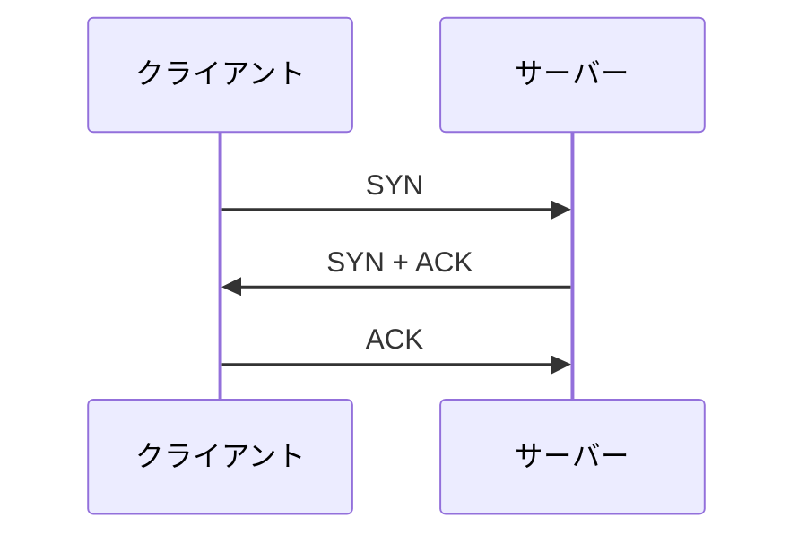

# Mermaid 図の書き方

ブログは ```` ```mermaid ```` のコードブロックをそのまま図として描画する．構造の図はこれで書く．
画像ファイルやスクリプトは不要で，記事にコードブロックを貼るだけで済むのが利点である．数値を伴うグラフは `references/figures.md` に従って Python で描く．

## 1. Mermaid を使う場面

- **処理の流れ・手順**：アルゴリズムの分岐，作業手順，ビルドやデプロイの流れ → `flowchart`
- **やりとりの順序**：通信プロトコル，クライアントとサーバー，関数の呼び出し順 → `sequenceDiagram`
- **状態の変化**：プロセスの状態，TCP の状態，有限オートマトン → `stateDiagram-v2`
- **構成・依存関係**：モジュールの依存，クラスの関係，ディレクトリ構成 → `flowchart` か `classDiagram`
- **Git の履歴**：ブランチとマージの様子 → `gitGraph`

本文の文章だけで十分伝わるもの（2〜3 要素の単純な関係など）は図にしない．

## 2. 描き方

**可能な限りシンプルに作る．** 記録として読み返したときに，一目で構造がわかることが目的である．

- **1 図 1 メッセージ．** その図で伝えたいことを 1 つに絞り，細部や例外は本文に任せる．ノードは 10 個程度までを目安にし，多くなるなら図を分けるか本文に回す
- **装飾しない．** `style`，`classDef`，色指定，アイコンは使わない．ブログのテーマ（ダークモードを含む）に任せる
- **向きはスマホでの横幅を考慮して選ぶ．** スマホでは横に長い図が縮んで読めなくなる．横に 4 つ以上並ぶ流れは `flowchart TD`（上から下）を検討する．ただし短い流れや，左右に並べたほうが自然な図は `LR` でよい．`sequenceDiagram` は参加者を 4 人程度までに抑える
- **ラベルは記事の言語に合わせる．** 見出しや本文が日本語なら日本語，英語なら英語にする．コマンド名・関数名・プロトコル名など固有のものはそのまま書く
- **ラベルは短い語句にする．** 文章をノードに詰め込まない．説明は図の前後の地の文に書く
- **記法は記事に合わせる．** 用語や略称は本文と同じものを使う

## 3. よくある構文エラー

Mermaid は 1 か所でも構文エラーがあると図全体が表示されない．描画を確認できる環境がないので，書いた後に次の点を目で確認する．

- **ラベルは `"..."` で囲む．** `()`，`[]`，`{}`，`:`，`;`，`#`，`/`，日本語などを含むラベルは，囲まないとエラーになることがある．迷ったら常に囲む（例：`A["SYN を送信 (seq=x)"]`）
- **ノード ID は英数字にする．** ID とラベルを分け，ID は `A`，`B` や `client` のような英数字にする（例：`client["クライアント"]`）
- **予約語を ID にしない．** 特に `end` は flowchart や subgraph を壊す．`End` や `done` などにする
- **ラベル内で `"` を使わない．** 必要なら `#quot;` を使うか，言い回しを変える
- **改行は `<br>` を使う．** ラベル内で `\n` は改行にならない
- **数式（`$...$`）をラベルに入れない．** ブログ側の対応が不明なので，`x^2` のような短い記法か言葉で書く
- **矢印の書き方を図の種類で混ぜない．** `flowchart` は `-->` と `-->|ラベル|`，`sequenceDiagram` は `->>` と `-->>`
- **`sequenceDiagram` のメッセージに `;` を入れない．** 文の区切りとして解釈される

## 4. 差し込み位置と文章

差し込み位置の決め方，導入文の書き方は `references/figures.md` の 5 節と同じにする．ブロックの形だけ次のように変える．

````markdown
<図を導入する 1〜2 文．何を描いた図で，どこを見てほしいか>



<必要なら，図から読み取れることを 1〜2 文．前後の本文と重複するなら書かない>
````

- 画像パスの書き換えは不要なので，その一言は添えない
- 本文モードで入れる場合は，`.md` の本文中に最初からこのブロックを入れ，図に言及する文（「下の図のように〜」）も自然に組み込む
- 図作成モードでチャットに示す場合は，Markdown ブロック全体を ````` ````markdown ````` のように外側を 4 つのバッククォートで囲み，中の ```` ```mermaid ```` が崩れないようにする
- 図の見出し（`### 01_xxx` など）には，Python の図と通しで番号を振る

## 5. 出力前のチェック

- ノードが多すぎないか，1 図 1 メッセージになっているか
- 横に長くなりすぎていないか（スマホで読めるか）
- `style` や色指定を入れていないか
- 記号や日本語を含むラベルがすべて `"..."` で囲まれているか，ID に `end` などの予約語がないか
- ラベルの言語・用語が記事と揃っているか
- コードブロックの言語名が `mermaid` になっているか
